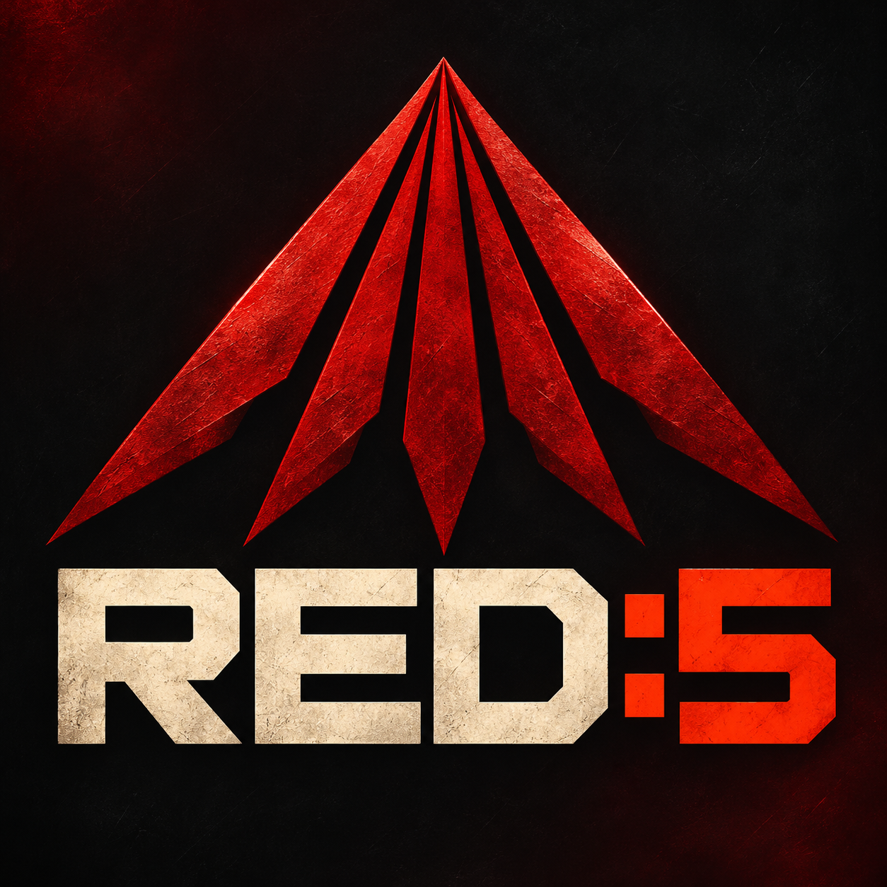
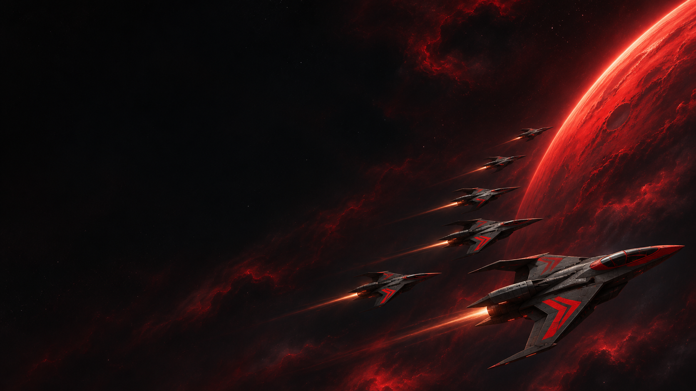

# RED:5

An unofficial PS5 port project for **Star Wars: Rogue Squadron II – Rogue Leader**, based on [Red Two](https://github.com/gminustwo/red_two).

[Availability](#availability) · [Compatibility](#compatibility) · [Help](#help) · [Credits](#credits)

## Availability

**In development. No PS5 release is available yet.** When a verified PS5 build is ready, look for it on the [RED:5 Releases page](https://github.com/BaZZtian/RED-5/releases). Development test programs are not a playable game and are not offered as downloads.

The separate upstream [Red Two v1.2 release](https://github.com/gminustwo/red_two/releases/tag/v1.2) provides Windows and Linux packages. Those packages are **not PS5 applications**. Follow upstream's own requirements and instructions if you want its PC version.

## Compatibility

No PS5 firmware, loader, game edition or controller configuration is currently approved for gameplay. Limited development tests do not establish game compatibility.

The intended first game edition is PAL `GSWP64`; USA `GSWE64` revision 0 is planned afterwards. Neither is a verified playable PS5 version. This project has no confirmed Rogue Squadron III implementation.

The planned PS5 application requires your own disc image and performs game-data processing on the console. A future public package must not include game assets or translated retail game code. No installation steps, save paths or controls are published until they are verified for an actual release.

## Help

Development is coordinated by [BaZZtian](https://github.com/BaZZtian). Follow this [project repository](https://github.com/BaZZtian/RED-5) or use its [issue tracker](https://github.com/BaZZtian/RED-5/issues) for RED:5 questions.

Please do not upload ISOs, game files, saves or memory dumps publicly. For questions about the existing PC application, use [upstream's issue tracker](https://github.com/gminustwo/red_two/issues).

## Credits

- **Red Two:** the upstream authors and contributors; see its [source](https://github.com/gminustwo/red_two) and [MIT license](https://github.com/gminustwo/red_two/blob/main/LICENSE).
- **PS5 port work:** BaZZtian's project, separate from upstream's PC releases.
- **RED:5 visual identity:** original AI-generated project artwork; see [branding notes](BRANDING.md).
- **Dependencies:** Aurora, Dawn, SDL, RADV, AsmJit and the PS5 homebrew toolchain have their own notices and licenses. A release must retain the applicable notices and required source/build information.

This project is not affiliated with or endorsed by Nintendo or Lucasfilm. Star Wars and Rogue Leader belong to their respective rights holders.
